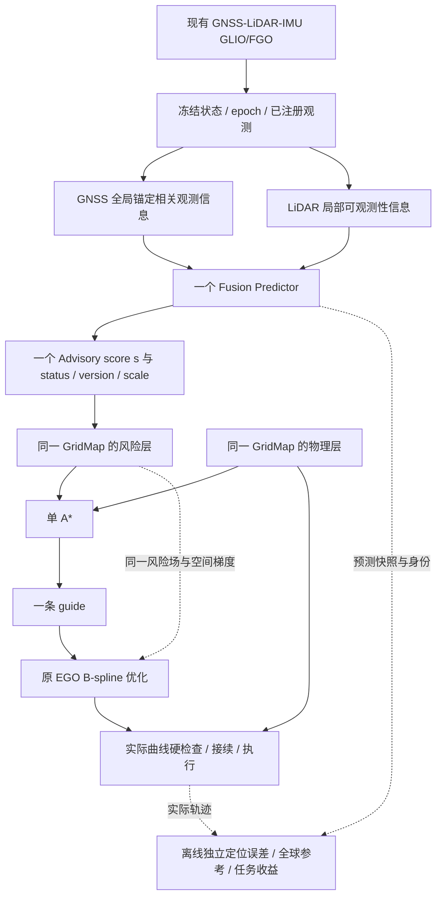

<!--
Repository target: docs/dev_predictor/advisory_development_plan_v1.md
Document revision: v1.3, 2026-10-13, proposed new scope.
This is a proposed replacement of the roadmap, NOT an automatic replacement of
active docs/spec contracts, goals, records, or execution-safety authorities.
-->

# IAP：定位退化 Advisory 与风险感知 EGO 前后端开发任务需求书

**版本：v1.3｜Route A + 前端风险 A* + 后端 PI 梯度｜2026-10-13**  
**开发结构：G2 → G3（G3-F、G3-B 两个内部里程碑）→ G4；G1 只读复用。**  
**建议仓库路径：** `docs/dev_predictor/advisory_development_plan_v1.md`  
**核查范围：** GitHub 可读取的 `dev/iap_refactor` 为 `2a6480f4`；用户报告本地后续 `9505b12a` 完成 G2-A0。本任务书依据可读取源码、用户提供的 G1 报告、G2-A0 模型契约制定；**不能据此假称已核验用户本地 HEAD、运行构建或最新提交的现场行为**。

> **总目标**：构造有独立证据支持的 GNSS–LiDAR 融合定位退化风险场；让同一张 `GridMap` 上的**一个**风险函数先进入 EGO 的 A* 前端选择 guide，再以**同一函数的空间梯度**直接进入 EGO B-spline 后端优化实际曲线；最后验证完整飞行任务的局部定位、全局锚定、执行安全与任务效率。整个系统保持“一个 GridMap、一个 A*、一条 guide、原 EGO 后端及原执行权威”。

**本项目不承诺**由瞬时几何指标给出正式 ARAIM 级完整性概率、长期漂移的精确预测或米级 PL 误差覆盖。未取得这些资格时统一称 *Localization-degradation Advisory / PI-inspired soft cost*，不得借名称把无量纲代理包装成正式 Protection Level。

## 00｜决策与研究范围

### 00.1 为什么合并为三个长期 Goal

| 长期 Goal | 研究内容 | 阶段交接条件 | 不承担的任务 |
| --- | --- | --- | --- |
| **G2 — Advisory 定位退化风险资格** | GNSS 全球参考约束与 LiDAR 局部运动约束的单源验证；联合风险模型、空间排序、可用性与数据资格 | 获得可解释、可计算、经独立验证、版本冻结的**唯一风险分数**及有效性语义 | 不改 A*、后端梯度或执行政策；不要求正式 PL 覆盖 |
| **G3 — Risk-aware EGO 规划器** | **G3-F**：A* 空间风险积分与单 guide；**G3-B**：在原 EGO 优化目标中加入真实 PI 风险积分及控制点梯度；前后端共享风险场 | F/B 分别完成确定性验收，且联合实际 B-spline 对应、预算和物理检查通过 | 不重新训练/调整已冻结 Predictor；不引入独立规划器或第二套风险场 |
| **G4 — 完整任务与三组消融** | Baseline / Front-only / Full 的完整任务对照、局部定位、全局漂移、停顿与安全评价 | 按原规则到达且独立真实定位收益成立，结论限定于所验证条件 | 不以自算风险低或单次成功代替实际收益 |

**G1** 既有 37 项数值机制回归可复用，原总体 `BLOCKED / MODEL_GAP`、旧 M2–M5 未完成、V5 及 paired-response 的 FAIL 原样留存；Route A 范围变化只解除“必须补全有符号创新联合物理律才能研发代理”的前置要求，**不是回溯宣布旧 Goal 通过**。已完成的 G2-A0 也是**方案通过，不是候选性能通过**。

### 00.2 三个不同的“可信”层次

1. **计算可信**：输入来源、坐标时刻、GNSS 准入、LiDAR 可见支持和共同 6DoF 信息矩阵有据可查，数值测试能复现。
2. **定位退化可信**：在冻结后的未见数据中，空间风险排序对实际定位质量具有稳定解释；区分短时相对运动误差与长期全局锚定作用。
3. **规划收益可信**：单 A* 确实选出较低累计风险 guide；EGO 直接 PI 梯度使**实际 B-spline**改善；完整 OFF/ON 消融的独立定位效果可见。

前一层通过不能替代后一层。最终不能只以 PL 热力图、漂亮的 guide 或更低自算 cost 宣称任务成功。

## 01｜现有代码事实及最小改造边界

| 当前事实（可读取远端源码与已交付 G1/A0 证据） | 对开发的影响 |
| --- | --- |
| `GridMap` 已同时持有物理与风险信息，并提供冻结预测和规划风险查询。 | **只复用同一个 GridMap**；不创建 `RiskGridMap`、平行 risk server 或长期 PI 字段管理器。 |
| `AStar::segmentCost()` 已对 `cost_multiplier + physical_unknown_cost` 做按长度的边积分。 | G3-F 不是重写 A*，重点是连续入口、语义及真实选择的验证。 |
| `BsplineOptimizer::assessGuideRetention()` 已比较 guide 与实际 B-spline 的风险积分。 | 此为**优化后检查**，不是 PI 代价对控制点的直接梯度；可作 G3 的对照和回归。 |
| `combineCostRebound()`/`combineCostRefine()` 目前是平滑、物理避障、动力学、fitness 等项。 | **没有独立 PI 空间梯度项**，这是 G3-B 的核心新增功能。 |
| `PICostAdapter::evaluate_with_gradient()` 接收传入梯度。 | 不能把此函数等同于从 GridMap 计算风险梯度或已接入 EGO。新实现先复用既有优化器接口。 |
| `BsplineOptimizer::planningOccupied()` 在部分入口把 `AVOID` / `PREDICTED_DEGRADED` 当作“占据”。 | G3-F 必须审查并最小拆分“物理占据 / 软风险偏好”，高 Advisory 不能自动成为硬障碍或停飞条件。 |
| G1 的受检输入：GNSS 改善传入 Fusion H/V，但 V 主导且旧倍率封顶为 3。 | G2 不能以旧米制 H/V 预算映射无量纲 S；G3 必须检查唯一代价是否保留已证实的风险差异。 |
| G2-A0 在 `advisory_joint_model.md` 中选定 `pose6_horizontal_probe_geometry_a0`。 | 先做最小离线实现与开发拒绝检查。探针模型是**局部几何敏感度候选**，尚未证明全球 GNSS 锚定价值。 |

**现场实现以本地工作区为准**。Codex 开始前先检查分支、HEAD、dirty diff、实际二进制/安装字节和有效参数；仅增量复查与可读源码不一致的部分。不能覆盖用户更改或声称远端 `2a6480f4` 就是现场的 `9505b12a`。

## 02｜目标系统与统一风险接口

### 02.1 运行时只保留一个权威风险场

- `s(p)`：位置相关、**越大越差**的融合定位退化分数，带 `valid/status`、`model_version`、`scale/semantic_id`。G2 已有 A0 候选时，`s` 为无量纲，**不是米制 HPL/VPL、真实误差 RMS 或正式 PL**。
- `c_PI(p) = φ(s(p))`：给 A* 与 EGO 共用的**一个**局部软成本函数。`φ` 在 G3 预声明，需单调、尺度相容、足够保留有意义差异，不能暗用旧米制 H/V 阈值；独立 GNSS/LiDAR 成本不进入规划器。
- `GridMap` 保留物理占据、物理未知、几何净空和风险状态两种独立语义；**风险为软偏好，不是物理通行许可**。Current Monitor/FDE、当前 FGO 运动质量与最终执行检查继续由现有权威处理。
- 不另建 `GlobalAnchoringRiskManager`、`LidarLocalPlanner`、`PIFieldPredictor`、第二套 A* 或另一个曲线优化器。来源级量只出现在原 Predictor 或离线验证中。

### 02.2 GNSS 和 LiDAR 的物理职责，及其验证边界

| 能力 | 内部解释 | 验证对象 | 必须承认的限制 |
| --- | --- | --- | --- |
| **GNSS：全局锚定** | 经 GNSS 准入、FDE、卫星几何与有效测量噪声提供相对 ECEF/ENU 参考的绝对位置约束 | 控制 LiDAR 几何近似一致时的 GNSS 条件，比较全局位置误差、固定全球参考下漂移、重获 GNSS 后的实际修正 | 当前瞬时 `horizon=0` FIM **不自动预测未来累计漂移**；可靠 GNSS 不等于卫星数量多 |
| **LiDAR：局部运动约束** | 在当前自建/注册地图支持下，扫描几何对位姿与短时间运动的条件约束 | 控制 GNSS 条件近似一致时的 LiDAR 几何，比较 1 s 相对位姿增量误差、弱方向和失配 | 自建地图的共同全球偏差未被当前几何 FIM 覆盖；独立测绘的已知全局地图是另一条件 |
| **Fusion：单一规划风险** | 使用同一共同位姿/原钟差与相关性假设，将两源信息转成唯一空间退化代理 | 四象限组合（GNSS好/差 × LiDAR好/差）、同输入消融、原排序与空间区分能力 | 两源物理作用不能凭 `max(Q_H,Q_V)` 自动宣称得到；这只区分 H/V 轴，不等于 GNSS/LiDAR 角色 |

*验证安排*：全局和局部是**两组离线证据**，不是两套在线规划代价。单个瞬时 `s(p)` 是否能同时体现两类条件，是待检验的研究假设；不能强制要求每个位置的 GNSS 提升都使 A* 绕路，但应在预声明的**显著且可用** GNSS 锚定差异下展示有物理意义的响应。若确实无法体现，明确报告“仅具局部几何排序资格”，不得声称全局锚定感知规划已经实现。

## 03｜共同开发约束（所有 Goal）

| ID | 不可改变的约束 |
| --- | --- |
| C01 架构最小性 | 单 GridMap、一个 A*、一条 guide、原 EGO 后端；不增候选路线竞赛/第二个 risk manager/辅助轨迹优化器。 |
| C02 单一在线代价 | GNSS/LiDAR 分别诊断，只有一个融合 `s` 和一个 `c_PI`；G3 可有前后端优化系数但不能重新定义两套风险含义。 |
| C03 运动许可独立 | 高风险、无效、过期不得伪装成物理占据或直接授权制动；现有物理/动力学/环境/当前 FGO、服务端确认与受检后备维持权威。 |
| C04 估计器不改 | GLIO/FGO、GNSS FDE、Current Monitor 不因模型开发随意改算法和阈值；prior OFF、冻结空间假设保留，除非另有有据范围变更。 |
| C05 真实与未来隔离 | 未来扫描、真实定位误差及真值只能用作**离线标签**，不能进入在线 Predictor/地图/路径搜索。 |
| C06 历史失败不可消去 | V5 反序、paired-response FAIL、G1 BLOCKED、旧 M2–M5 全部保存。旧数据仅开发归因，独立冻结后采新数据。 |
| C07 固定任务与实时预算 | 原四分叉环境、原起终点 `[-18,0,1.5]→[18,0,1.5]`、300 s 到达、search 1 s / planning transaction 1.5 s、原 NAV / 安全 / 接续政策，除非明确另行授权。 |
| C08 数值及状态语义 | rank-deficient / stale / unknown 不输出虚假有限低风险；旧 HPL/VPL 米制监测和新无量纲 Advisory 严格分型/版本，不能类型偷换。 |
| C09 可复现与保留 | 使用已有 run resolver / manifest / 有界 writer；按完整 producer/run 统计独立性，记录模型与数据身份；不重复大规模日志。 |
| C10 自主推进 | Codex 在已批准的模型/实验预算与变更边界内可自行修复、复跑定向测试、推进下一内部里程碑；**不因中途失败或一个子阶段完成而要求用户逐项批准**。必须变更目标、科学评价对象、安全许可或超出预算时才升级范围决策。 |

## 04｜G2：Advisory 风险场资格（一个完整研究 Goal）

### 04.1 目标与已有成果

G2 同时回答两个问题：**(a) 一个预测时可计算的融合风险是否能排序实际局部定位退化；(b) 是否在独立证据下合理体现 GNSS 全局锚定和 LiDAR 局部观测的互补性。** 两者分别留证，不能由“融合矩阵数值正确”推断真实效果。

从既有 G2-A0 候选 `pose6_horizontal_probe_geometry_a0` 开始，而不是重新开一个抽象模型设计 Goal。既定探针长度 `0.5 m`、共同 6DoF、原 clock/相关性、prior OFF、`Q_H/Q_V/S` 和缺失状态语义不任意修改。A0 方案通过、模型通过尚未取得。

### 04.2 工作包（Codex 连续完成，不再按每一步停工）

**G2.1 — 唯一候选的最小离线实现与可证伪比较。** 复用冻结 Fusion 6D 信息，对 4 个固定水平探针作同矩阵投影，独立 SVD、零探针、对称性、不可观方向及 GNSS/LiDAR 消融核对。输出 `Q_H/Q_V/S` 的无量纲语义；不改米制 PL 字段、不接入生产 cost；先用已有 7400 和历史完整输入做**一次**开发拒绝检查。与 V5 没有可分辨新信息、原相对误差排序仍明显错误或只靠新增 unavailable 得到改善时必须拒绝；不得扫 0.5m 探针长度、K、来源比例或区域阈值。

**G2.2 — 单源物理作用的受控对照。** 使用同一估计器/场景配置预声明四类条件：GNSS 好/差、LiDAR 好/差的组合。对 GNSS 对照保持 LiDAR 观测尽可能一致，区分实际有效星座、NLOS/FDE 与“名义可见”；观察有可靠全球参考时的位置误差和漂移校正。对 LiDAR 对照保持 GNSS 条件尽可能一致，观察局部 1s 增量误差和弱方向。任何难以严格隔离的共享地图与估计器耦合应记录，而不是宣称绝对因果。所有真实误差只离线评估。

**G2.3 — 单一融合分数的响应与模型决策。** 在 GNSS 敏感、LiDAR 敏感和双源退化样例上同时比较 `S`、`Q_H/Q_V`、有效性/unknown、GNSS/LiDAR 观测贡献和真实局部/全球指标。检查空间是否具有可分辨梯度信息，尤其不能以 V 代理封顶导致全路同分。若 G2-A0 拒绝，允许在**已有新反例支持下**选取至多一项数学上实质不同的最小候选；禁止同一假设大量微调或通过未来真值选区域。若证据只支持局部定位而不支持全球锚定，应限缩声明并申请**一次明确的研究目标决定**，不能暗称二者皆有效。

**G2.4 — 数据充分性、冻结与独立验证。** 当前 7400 中合格的原生样本不足，不得授予资格。允许在经用户采纳的长期 Goal 预算内，按 A0 已预登记的**最多一份 105 s 开发记录**补齐分析；一次完整 producer/run 仍只算一个独立来源。开发模型/评价规则冻结后，执行三次全新独立运行的资格验证；不得失败后无实质模型变化就反复换 seed。无法满足输入或留出资格记 `INCONCLUSIVE/BLOCKED`，不捏造 PASS。

### 04.3 验收标准与交付

| 验收项目 | 通过要求 |
| --- | --- |
| 数值正确 | 适用 G1 回归仍成立，0.5m 投影可观性正确、独立矩阵核对通过；单源 invalid 不以 0 冒充高信息。 |
| 原局部主排序 | 固定 1.000 s 原生 GLIO 参考端点；`S` 对 XY、`Q_H` 对 XY、`Q_V` 对绝对 Z **各自**按 A0 契约检查。预登记三区域和缺失分母；区域 concordance ≥0.7、运行内 Spearman ≥0.5、每运行至少 6 个合格窗口、至少 2 个预声明区域，**三次独立运行均通过**。指标近于噪声/聚合不确定性时为 INCONCLUSIVE。 |
| 全球锚定作用 | 独立对照报告 GNSS 有效锚定条件与真实全球参考误差/漂移的关系；确认融合 `S` 在 GNSS 有效且差异足够时的响应及是否被 LiDAR 主导抹去。**不把单点 S 当长期漂移估计**。不得在无证据时宣称全球锚定规划已验证。 |
| LiDAR 局部约束 | 独立对照报告可见支持/弱方向与真实局部误差响应；保持地图来源与绝对基准误差的局限说明。 |
| 唯一风险语义 | 输出一个明确定义、有效状态、单位/尺度、版本、模型身份的 `s(p)`；无效不转换成伪小值。以后 G3 仅消费此接口。 |
| 性能与缺失 | 冻结姿态/信息准备、查询及 cache miss 计时；无未经批准的历史观察者、第二地图或动态漂移估计。 |

**G2 交付**：同一份模型契约的修订、单源与融合对照结果、独立资格报告、冻结 manifest、一份可重放的 `s` 空间输入/状态与下一 G3 的接口契约。没有独立通过就不能以**真实风险**名义开始 G3 的正式选路收益验收；但 G3-F 可用人工构造风险场做纯机制回归准备。

## 05｜G3：Risk-aware EGO 前后端（一个持续 Goal，两个内部里程碑）

G3-F 与 G3-B **不再分别要求用户发新 Prompt**，可以连续开发、独立提交和内部验收。它们共享同一个 `s → c_PI`、同一个 GridMap 缓存及同一冻结规划输入。F 先完成稳定接口，B 在其上直接增加实际轨迹 PI 梯度。

### 05.1 统一成本约定

前端对每一空间边按其实际长度积分唯一成本，保留物理未知和其他既有路径代价：

`J_A*(π) = ∫_π [1 + λ_A c_PI(p)] ds + J_existing_physical_unknown/terminal`。

后端不替换原 EGO，只在原目标中加入同一风险场的轨迹积分：

`J_EGO(P) = J_original_EGO(P) + λ_B J_PI(P)`，  `J_PI(P) = ∫ c_PI(x_P(t)) ||x'_P(t)|| dt`。

其中 `x_P(t) = Σ_i B_i(t) P_i`。`λ_A` 与 `λ_B` 可因两端原有目标尺度不同而独立声明，但两端 **`c_PI` 必须同义、同版本、同源、单调**，不允许 GNSS、LiDAR 分别设置规划成本或梯度。原 `PI=AL−PL` 只有在指标实际满足该含义时才能使用；无量纲候选只称 PI-inspired Advisory cost。

若采用上式弧长积分，控制点的解析梯度需至少包含（可用同等正确离散求积实现）：

`∂J_PI/∂P_i = ∫ [ B_i(t) ∇c_PI(x_P(t)) ||x'_P(t)|| + c_PI(x_P(t)) B'_i(t) x'_P(t)/||x'_P(t)|| ] dt`。

导数奇点、积分采样、固定端点和未知区域必须有数值处理策略；不得忽略第二项却宣称求得完整弧长 PI 梯度。先做有限差分核验，再接 LBFGS。若选择另一个等价离散目标，必须明确其与 A* 累积风险的一致性和差异。

### 05.2 G3-F：前端 A* 任务（独立功能验收，不要求后端 PI 最优）

- **复用现有路径搜索**：`GridMap::capturePlanningRiskQuery`、`AStar::segmentCost` 及现有 guide 入口。冻结同一版本模型、查询有效状态、物理已知/未知、任务推进与搜索预算。
- **清理语义混淆**：检查 `planningOccupied()`、段选择和 `check_collision_and_rebound()` 中 Advisory 是否被解释成实体障碍。风险只参与可行边上的**软代价**；物理碰撞、真实 unknown/clearance 由原物理查询决定。允许一个最小职责修正，不新增状态机或风险图。
- **必做主动绕行机制测试**：在全部物理可通行的固定地图上，给出高风险带与绕行代价；当**累计风险下降足以抵消额外长度**时，A* 必须选择低风险 guide。不要求任意微小差异都绕行。
- **双源差异测试**：LiDAR 近似相同而 GNSS 有可靠差异，及 GNSS 相近而 LiDAR 不同；比较冻结 `s`、边积分、整路长度/累计风险、guide 路线，而不是比较最低局部 PL 点。
- **证据边界**：纯合成 risk grid 只证明算法机制；使用 G2 合格真实数据才是前端真实选路验证。当前 EGO 仍做物理可行性和原后端流程，但不要求 Front-only 独自降低**最终 B-spline 的 PI 风险**。

**G3-F 内部 PASS**：有障碍和无障碍风险选择机制、代价积分、实际合格 `s` 的整路选择、失败/unknown 语义、1 s 搜索预算均成立；得到一条 guide。**此 PASS 不代表实际轨迹 PI 优化完成。**

### 05.3 G3-B：后端 EGO 直接 PI 梯度（新增实质研究功能）

- **在原 `BsplineOptimizer` 加一项、不是加一个优化器**：复用 `combineCostRebound()`/`combineCostRefine()` 的既有成本及梯度求和接口；仅新增必要的 PI cost/gradient 计算，按移动自由度加至原目标。
- **同一 GridMap 提供梯度**：使用同版本邻近有效风险样本的空间插值（例如局部三线性及其分段梯度），实现 `∇c_PI(p)`；不得把 `AVOID/UNKNOWN` 等枚举差分当连续物理梯度、不得跨不相容版本插值。按现有缓存模式复用数据，不建第二 PI map。
- **数值机制验收**：连续小测试场中的 PI 值、解析/插值空间梯度与有限差分一致；控制点梯度与整个 `J_PI` 有限差分一致；零曲线速度、空间边界、invalid/stale、截断饱和和版本切换有定义好的有界行为。
- **优化效果验收**：同一初值和同一冻结风险版本下，Full 与 Front-only 对比实际曲线的风险积分、几何长度、最小净空、动力学、端点和求解耗时。梯度应对有可改善空间的情形产生可辨改进；不能以失去任务进展、逼近障碍或频繁停车换取风险下降。
- **保留现有执行语义**：实际曲线最终物理与运动检查、接续 P/V/A、服务端激活、合格旧轨迹和受检停车后备不变。风险缺失时软项按预声明中性/保守策略处理，不产生任意数值驱动或运动否决。
- **性能**：评估冻结预测准备、A* cache miss、风险插值采样、LBFGS 迭代和最终硬检查；保持原 search 1 s、事务 1.5 s 的约束，禁止无限多点风险求导。

**G3-B 内部 PASS**：实际 B-spline 的**PI 目标值与控制点梯度都通过数值核验**，可改善的样例中 Full 比 Front-only 取得更好的实轨迹 PI 目标，同时原物理/动力学/任务推进/接续和预算不回退；完成真实合格风险场下的 route → guide → 曲线证据。

### 05.4 G3 整体通过条件

G3-F 和 G3-B 全部通过，且同一场、同一版本、同一任务中两端证据能关联；不能只因 guide 不变而否决后端细调，亦不能只因曲线自算 cost 下降而宣布真实定位收益。真实独立定位收益属于 G4。

## 06｜G4：完整任务与最少三组消融

### 06.1 三种运行配置：同一代码、开关不同

| 模式 | Risk-aware A* | PI-gradient EGO | 证明什么 |
| --- | --- | --- | --- |
| **B0：Baseline** | 关闭 Advisory 偏好，保留原物理路径能力 | 关闭 | 当前同仓库工程基线；不误称“完全未改动的上游 EGO” |
| **B1：Front-only** | 打开 | 关闭 | 风险 A* 前端对实际任务的增量贡献 |
| **B2：Full** | 打开 | 打开 | 后端梯度在前端基础上的增量收益及完整方案 |

三种模式仍保持 GNSS/LiDAR/IMU、GLIO/FGO、FDE、物理环境、起终点、未知政策、安全检查和预测记录一致。**仅禁用规划偏好与 PI 梯度，不禁用传感器或 FDE。** 不默认增加 `Backend-only` 第四组；若论文需要独立估计后端无前端条件下的主效应，可作为另行预声明的补充消融。

### 06.2 主要与辅助评价

| 类别 | 实际验收与报告 |
| --- | --- |
| **局部运动定位** | 原 v1.2 固定 1.000 s GLIO 原生端点水平相对增量误差；按全任务实际推进弧长、覆盖率和窗口身份报告。G2 原排序规则继续保留，不得从 G4 抽样反向调 Predictor。 |
| **全局 GNSS 锚定** | 固定统一全球坐标参考下的绝对位置误差/漂移增长、GNSS 可靠锚定时段与缺失、重获卫星后的实际校正；作为**独立的长期效果证据**，不当成第二在线 cost。若 Full 改善局部而显著恶化全球，必须报告，不称整体定位更可靠。 |
| **曲线和任务** | 预测风险与**实际 B-spline** 的 PI 累计代价、长度、到达时刻、完整轨迹、服务端接续和停顿，不拿 guide 或自算风险代替真实结果。 |
| **安全与效率** | 物理净空、实际动力学/跟踪、硬检查失败、故障/后备、预算、非终点低速采样（明确非连续时长）。 |
| **统计与公平** | 预登记匹配种子/配置、随机顺序、真实误差评价器、缺失分母、改善效应和不确定性；一整次运行是独立单位，连续窗口不是独立运行。 |

**起始安排建议**：每个共同配置/种子执行 B0、B1、B2 三种模式，至少三组独立配对（共九次完整运行）作为初始有界计划，而不是原先两臂 OFF/ON 的六次。若原验收契约对配对数更严格则优先；正式数量、时间窗和主要效应判据必须在看结果前冻结。所有模式按**原 300 秒任务到达规则**完成，任何失败和 missing 不删除。

**G4 PASS** 不能只依据某一个差值方向：原任务均按规则完成，B1 相对 B0 的前端作用、B2 相对 B1 的后端实际曲线作用与独立定位误差收益均有预声明证据，且安全与在线预算无退步。少量仿真配对不授予认证级风险概率或跨场景保证。

## 07｜连续自主执行政策：减少人工授权，不放宽科学门槛

1. **一次任务授权范围**：G2 → G3-F → G3-B → G4，内部达到明确门槛自动继续，不把每次开发拒绝检查、补足一份已授权开发数据或相关 Bug 修复交还用户；工作区与源码变更仍依 `AGENTS.md` 做有界测试、提交和证据登记。
2. **科研自纠错**：每次失败执行“观测到的首个不变量 → 有物理依据的假设 → 最小反证实验 → 修复或拒绝”。已有样例 PASS 后不反复重做；没有具体新信息就不盲目换 seed、调 K 或添加字段。
3. **研究预算**：默认首先测试 A0 唯一候选；明确反证后至多一个实质不同的替代模型假设（不是同假设参数扫描）；开发样本不够时至多一次 A0 已预登记的 105 s 补充记录；每一冻结候选至多一次三独立运行正式资格；G4 初步最多三组三臂任务。任何额外工作需范围决策。
4. **允许自动修复**：已记录生产 bug、接口状态/量纲错用、软风险伪装硬障碍、导数错误、单一版本缓存错误、确定的物理/接续回归问题。不得自动改变实际 FGO、场景 NAV、运动许可、原安全阈值、评价对象或接受标准。
5. **科学停止条件**：物理输入确实不可获得；已授权候选和数据预算用尽且无有证据的新假设；独立验证明确未通过；合约无法在不改变目标/安全/预算的情况下同时满足。此时输出 `EVIDENCE_BASED_BLOCKED` 和明确研究边界，不能改称 PASS。
6. **报告与提交**：每个内部里程碑可简短记录状态、commit、复现入口和唯一下一步，然后自动执行下一阶段。最终只允许 `SUCCESS`（全部资格与任务收益成立）或有依据的 `BLOCKED`，不因文档完成而停止。

## 08｜落地与文件职责（勿增实体）

| 现有文件 | 修改责任 |
| --- | --- |
| `docs/dev_predictor/advisory_development_plan_v1.md` | 本任务书，负责授权与阶段边界；文件路径保留以免破坏旧 Prompt 引用，正文升到 v1.3。 |
| `docs/dev_predictor/credible_local_risk_goal.md` | **唯一活跃状态入口**：记录已采用的范围、当前 Goal、历史 FAIL/旧 G1 BLOCKED、独立验收进度、最新本地提交。 |
| `docs/spec/advisory_joint_model.md` | 保留 G2-A0 候选和资格条款；候选修正只更新必要科学语义、有效性和输出接口，不改旧失败。 |
| `docs/spec/local_increment_advisory_contract.md` | 原 1s 原生 GLIO 评价、数据身份、门槛与留出；如科学对象要变则单独授权，不能默改。 |
| `docs/spec/ego_based_planning_flow.md` | 原流程、当前风险 A* 已实现的界限、后端 PI 梯度计划/通过状态、相关证据，按仓库规则增量更新。 |
| `docs/adr/0004-single-route-safety-planner-v1.md` | 阶段 1 的 guide-only 设计不等于永久禁用后端 PI；若最终增加梯度改变已采纳架构承诺，应附明确后续阶段决策说明而非静默覆盖。 |
| `src/iap/planner/...` | 优先在已有 `GridMap` 查询、`AStar`、`BsplineOptimizer` 中实现最小函数/字段；不存在充分必要性时，不创建新的库、管理器或风险地图。 |

**部署操作**：本文件是需求草案，不代表已对用户本地仓库提交任何改动。落地时合并旧证据引用、保留用户未跟踪文件；在 active-goal 入口明确引用本路径及其版本。后续 Codex 必须先读取全文和 G2-A0 当前候选，才开始连续实现。

## 09｜结论强度与源码依据

**当前可以宣称**：已有 G1 数值机制审计；G2-A0 已形成单一可证伪候选；前端存在 risk A* 和 guide 风险留存接口。**不能宣称**：A0 指标已通过独立排序、能预测长期 GNSS 漂移、后端已有直接 PI 梯度、完整 Front-only/Full 已提高实际定位质量。

仓库依据（远端可读 `2a6480f4`；本地新提交先现场比对）：

- [ADR 0004 — Single-route Safety Planner](https://github.com/Printeger/iap/blob/2a6480f4860959722236d4425be39e50b001e254/docs/adr/0004-single-route-safety-planner-v1.md)
- [GridMap 风险倍率与冻结风险查询](https://github.com/Printeger/iap/blob/2a6480f4860959722236d4425be39e50b001e254/src/iap/planner/plan_env/src/grid_map_risk.cpp)
- [A* segmentCost() 实际边积分](https://github.com/Printeger/iap/blob/2a6480f4860959722236d4425be39e50b001e254/src/iap/planner/path_searching/src/dyn_a_star.cpp)
- [BsplineOptimizer：guide 保留与后端目标](https://github.com/Printeger/iap/blob/2a6480f4860959722236d4425be39e50b001e254/src/iap/planner/bspline_opt/src/bspline_optimizer.cpp)
- [BsplineOptimizer::planningOccupied 语义](https://github.com/Printeger/iap/blob/2a6480f4860959722236d4425be39e50b001e254/src/iap/planner/bspline_opt/include/bspline_opt/bspline_optimizer.h)
- [PI cost adapter 现有能力边界](https://github.com/Printeger/iap/blob/2a6480f4860959722236d4425be39e50b001e254/src/iap/planner/pi_cost_adapter.cpp)
- [Route A 的 G2-A0 候选](../spec/advisory_joint_model.md#route-a-g2-a0)（以用户上传的 9505b12a 后文件为依据）
- [原 1 秒局部增量评价与历史 FAIL](../spec/local_increment_advisory_contract.md)
- [原 G1 审计/低维物理律审查报告](../../log/20261012T163704Z_119/export/analysis/g1/REPORT.md)（对应用户已提供报告与证据）
